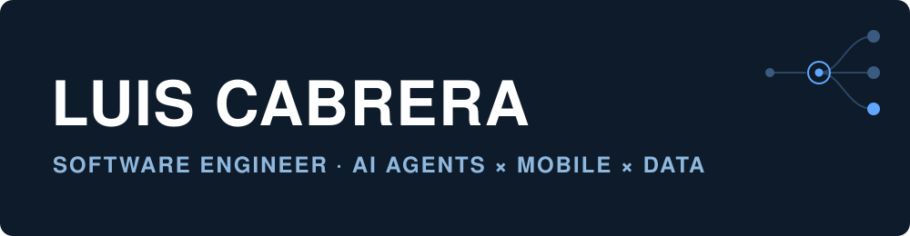
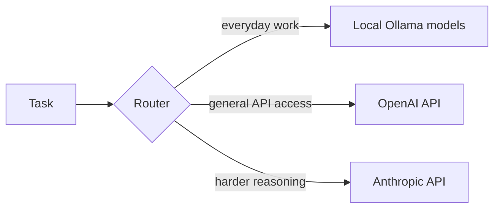

<div align="center">

<picture>
  <source media="(prefers-color-scheme: dark)" srcset="assets/banner-dark.svg" />
  <source media="(prefers-color-scheme: light)" srcset="assets/banner-light.svg" />
  
</picture>

<br/>

<a href="https://www.luiscabrera.me">
  
</a>
<a href="https://www.linkedin.com/in/luisecab/">
  
</a>
<a href="https://adoptsi.si">
  
</a>

</div>

<br/>

> ### Building the software foundations for the agentic era.

Product-minded software engineer at **P&G**, based in **Warsaw, Poland**.

I went from defining products to building them in 2025. Now I'm going deep on what sits underneath agents: how LLMs behave, how agent harnesses are built, and how to make agentic systems reliable, testable, and affordable enough to solve real problems every day.

---

## 01 · Focus

<table>
<tr>
<td width="50%" valign="top">

### Agent Harnesses

The loop around the model: tools, context, memory, permissions, and control.

**In practice:** Hermes, autonomous Claude Code loops.

</td>

<td width="50%" valign="top">

### LLMs

Local versus API models, routing by cost and difficulty, and knowing what each model is good at.

**In practice:** Ollama, OpenAI, Anthropic, and Grok in real workloads.

</td>
</tr>

<tr>
<td width="50%" valign="top">

### Multi-Agent Orchestration

Roles, handoffs, and routing across a team of agents.

**In practice:** an 11-agent crew with custom devops and researcher agents.

</td>

<td width="50%" valign="top">

### Software Fundamentals

Production code, tests, code review, APIs, reliability, and performance.

**In practice:** mobile engineering with Flutter and Dart at P&G.

</td>
</tr>
</table>

---

## 02 · Now

<table>
<tr>
<td width="50%" valign="top">

### Mobile Engineering

Software Engineer at P&G. Building and maintaining app features, integrating backend APIs, and working on reliability and performance.

`Flutter` `Dart`

</td>

<td width="50%" valign="top">

### [AdoptSI](https://adoptsi.si)

My company. AI agents for traditional businesses, plus websites and MCP servers that help SMBs integrate with AI.

`AI Agents` `MCP` `Automation`

</td>
</tr>

<tr>
<td colspan="2" valign="top">

### Agentic Engineering

Running **Hermes** and an 11-agent crew on my own infrastructure. Details in 03.

</td>
</tr>
</table>

---

## 03 · Agents & Projects

<table>
<tr>
<td width="50%" valign="top">

### `Hermes`

**Personal AI agent · active**

My current personal agent, self-hosted on a Hetzner server.

`Hetzner` `Node.js` `PM2` `Cloudflare Tunnel`

</td>

<td width="50%" valign="top">

### `Multi-agent crew`

**11-agent system · active**

Adapted from the My-Brain-Is-Full-Crew framework, combining reused agents with custom devops and researcher agents.

`Ollama` `OpenAI API` `Anthropic API`

</td>
</tr>

<tr>
<td width="50%" valign="top">

### [`FotoReady`](https://foto-ready.luisecab93.workers.dev/landing)

**AI product photography · MVP**

Turns a single amateur product photo into marketplace-ready listing images for small sellers in Mexico.

`React` `TypeScript` `Supabase` `Gemini AI`

</td>

<td width="50%" valign="top">

### `Polymarket agent`

**Betting agent · paper trading**

Starting with paper trading before anything live.

`Python` `Docker Compose` `py-clob-client`

</td>
</tr>

<tr>
<td width="50%" valign="top">

### `Autonomous coding loops`

**Agent harness · active**

Claude Code CLI workflows controlled from mobile through SSH and tmux.

`Claude Code` `SSH` `tmux`

</td>

<td width="50%" valign="top">

### `Grok bots`

**Bots on xAI's Grok · active**

Bots built on xAI's Grok models.

`Grok` `xAI API`

</td>
</tr>
</table>

### How the crew routes work



---

## 04 · Stack

<div align="center">


<details>
<summary><b>Full stack by area</b></summary>

### Mobile

`Flutter` · `Dart`

### Agents & AI

`Ollama` · `OpenAI API` · `Anthropic API` · `Grok (xAI)` · `Gemini` · `Claude Code` · `MCP`

### Web

`React` · `TypeScript` · `Supabase`

### Data

`SQL` · `BigQuery` · `GCP` · `Power BI` · `Tableau`

### CRM & Messaging

`Braze` · `Segment` · `Lifecycle messaging`

### Infra

`Docker Compose` · `PM2` · `Tailscale` · `Cloudflare Tunnel`

</details>

</div>

---

## 05 · Career

```text
2025 — now   P&G               Software Engineer, Mobile (Flutter/Dart)
2023 — 2025  P&G               Product Manager, global CRM & messaging
2021 — 2022  Foxtrot Systems   Account Product Manager
2020 — 2021  Mercado Libre     Product, Shipping
2019 — 2020  FREENOW (Beat)    Operations / Project Specialist
```

**SGH Warsaw School of Economics** · MSc Big Data & Advanced Analytics (2023 — 2025)<br/>
**National Polytechnic Institute** · BS Industrial Engineering (2013 — 2018)

---

## 06 · Retired & Hackathons

| | What it was |
| :-- | :-- |
| **Clawdbot** · retired | WhatsApp AI assistant |
| **Portal Trax** · retired | Android app experiment |
| **[Junction 2025](https://www.hackjunction.com/)** · participant | Hackathon in Espoo, Finland. Theme: Utopia & Dystopia |

---

## 07 · Ask Me About

`agent harnesses` · `AI agents` · `local LLM workflows` · `Flutter & Dart` · `CRM & messaging platforms`

**Career pivots, resilience, and building momentum after hard resets.** I'm a brain tumor survivor.

---

## 08 · Let's Connect

<div align="center">

<a href="https://www.luiscabrera.me">
  
</a>
<a href="https://www.linkedin.com/in/luisecab/">
  
</a>
<a href="https://adoptsi.si">
  
</a>

<br/><br/>

<sub>Building agents that do real work.</sub>

</div>
