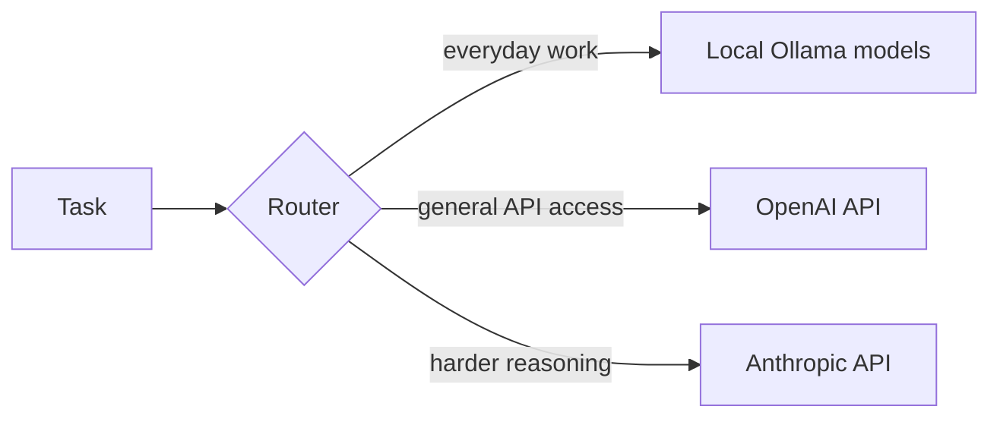

<div align="center">


<br/>

<a href="https://luiscabrera.me">
  
</a>
<a href="https://www.linkedin.com/in/luisecab/">
  
</a>

</div>

<br/>

> ### I build AI agents and the software around them.

Software engineer at **P&G**, based in **Warsaw, Poland**.

I work on messaging and CRM data platforms by day, and run my own agent infrastructure the rest of the time, getting closer to the implementation details and technical foundations of agentic frameworks.

---

## 01 · Now

<table>
<tr>
<td width="50%" valign="top">

### Messaging & CRM

Software Engineer at P&G, working on lifecycle messaging and the data behind it.

`Braze` `Segment` `BigQuery` `GCP`

</td>

<td width="50%" valign="top">

### Personal Agents

Building and running **Hermes**, my own AI agent, on a Hetzner server.

`Node.js` `Python` `PM2` `Tailscale`

</td>
</tr>

<tr>
<td colspan="2" valign="top">

### Mobile

Building mobile apps with Flutter and Dart.

`Flutter` `Dart`

</td>
</tr>
</table>

---

## 02 · Agents & Projects

<table>
<tr>
<td width="50%" valign="top">

### `Hermes`

**Personal AI agent · active**

My current personal agent, self-hosted on a Hetzner server.

`Hetzner` `Node.js` `PM2` `Cloudflare Tunnel`

</td>

<td width="50%" valign="top">

### `Multi-agent crew`

**11-agent system · active**

Adapted from the My-Brain-Is-Full-Crew framework, combining reused agents with custom devops and researcher agents.

`Ollama` `OpenAI API` `Anthropic API`

</td>
</tr>

<tr>
<td width="50%" valign="top">

### `Polymarket agent`

**Betting agent · paper trading**

Starting with paper trading before anything live.

`Python` `Docker Compose` `py-clob-client`

</td>

<td width="50%" valign="top">

### `FotoSeller`

**AI product photography · experiment**

Image pipeline for MercadoLibre and Amazon sellers.

`Gemini` `Ideogram` `Claude Vision`

</td>
</tr>

<tr>
<td colspan="2" valign="top">

### `Autonomous coding loops`

Claude Code CLI workflows controlled from mobile through SSH and tmux.

`Claude Code` `SSH` `tmux`

</td>
</tr>
</table>

<sub>Retired: Clawdbot (WhatsApp AI assistant) · Portal Trax (Android app experiment)</sub>

### How the crew routes work



---

## 03 · Stack

<div align="center">


### Agents & AI

`Ollama` · `OpenAI API` · `Anthropic API` · `Claude Code`

### Data

`SQL` · `BigQuery` · `GCP` · `Power BI` · `APIs`

### Messaging & CRM

`Braze` · `Segment` · `Lifecycle messaging`

### Mobile

`Flutter` · `Dart`

### Infra

`Docker Compose` · `PM2` · `Tailscale` · `Cloudflare Tunnel`

</div>

---

## 04 · Career

```text
2025 — now   P&G     Software Engineer, Messaging & CRM
2024 — 2025  P&G     IT Product Manager, Media Optimization
2022 — 2024  P&G     Initiative Operations Project Leader, Braun
```

**SGH Warsaw School of Economics**
MSc, Big Data & Advanced Analytics (2025)

---

## 05 · Ask Me About

`AI agents` · `local LLM workflows` · `CRM & messaging data platforms`

**Career pivots, resilience, and building momentum after hard resets.** I'm a brain tumor survivor.

---

## 06 · Let's Connect

<div align="center">

<a href="https://luiscabrera.me">
  
</a>
<a href="https://www.linkedin.com/in/luisecab/">
  
</a>

<br/><br/>

<sub>Building agents that do real work.</sub>

</div>
